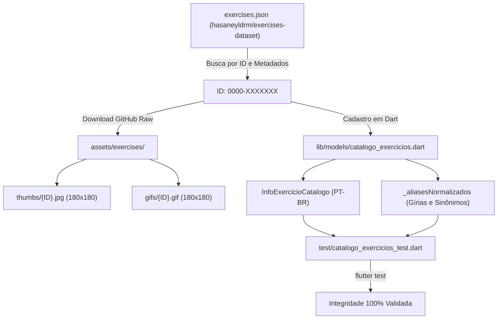

# Guia Técnico: Inclusão e Curadoria de Exercícios no Catálogo Offline

Este documento detalha o procedimento operacional padrão (SOP) para pesquisar, baixar mídias, cadastrar metadados e validar novos exercícios no catálogo 100% offline do **Gym Saiyajin**, utilizando como base o repositório aberto [`hasaneyldrm/exercises-dataset`](https://github.com/hasaneyldrm/exercises-dataset) (mídias © Gym Visual).

---

## 1. Visão Geral da Arquitetura

O sistema de exercícios offline do Gym Saiyajin é desacoplado entre dados estruturados e arquivos de mídia:



### Especificações Técnicas:
* **Dimensões e Proporção:** Imagens e GIFs padronizados em `180×180` pixels.
* **Miniaturas (.jpg):** Salvas em `assets/exercises/thumbs/<codigoMidia>.jpg`.
* **Animações em Loop (.gif):** Salvas em `assets/exercises/gifs/<codigoMidia>.gif`.
* **Registro de Assets:** O diretório já se encontra mapeado em `pubspec.yaml`:
  ```yaml
  flutter:
    assets:
      - assets/images/
      - assets/exercises/thumbs/
      - assets/exercises/gifs/
  ```

---

## 2. Ponto de Atenção Crítico: URLs do Repositório Remoto

> [!WARNING]
> No repositório remoto [`hasaneyldrm/exercises-dataset`](https://github.com/hasaneyldrm/exercises-dataset/tree/main), os diretórios de mídia seguem uma convenção específica. O diretório de animações se chama **`videos`** (e não `gifs`):
> * **Miniaturas:** `https://raw.githubusercontent.com/hasaneyldrm/exercises-dataset/main/images/<codigoMidia>.jpg`
> * **Animações:** `https://raw.githubusercontent.com/hasaneyldrm/exercises-dataset/main/videos/<codigoMidia>.gif`

---

## 3. Passo a Passo Operacional

### Etapa 1: Encontrar o Exercício e seu Código (`id`)
Para inspecionar o arquivo consolidado `exercises.json`, utilize o script de busca em Dart abaixo:

```dart
// search_exercise.dart
import 'dart:convert';
import 'dart:io';

void main() {
  final file = File(r'scratch/exercises.json');
  final data = jsonDecode(file.readAsStringSync()) as List;

  const termoBusca = 'hip extension'; // termo em inglês

  for (final item in data) {
    final nome = (item['name'] as String).toLowerCase();
    if (nome.contains(termoBusca)) {
      print('ID: ${item['id']}');
      print('Nome original: ${item['name']}');
      print('Equipamento: ${item['equipment']}');
      print('Músculo alvo: ${item['target']}');
      print('Sinergistas: ${item['secondaryMuscles']}');
      print('-----------------------------------------');
    }
  }
}
```

---

### Etapa 2: Baixar as Mídias para as Pastas do Projeto
Execute o script de download para salvar os arquivos estáticos e animados diretamente nas pastas do bundle:

```dart
// download_exercise.dart
import 'dart:io';

Future<void> baixarExercicio(String codigoMidia) async {
  const baseUrl = 'https://raw.githubusercontent.com/hasaneyldrm/exercises-dataset/main';
  final client = HttpClient();

  // 1. Download da miniatura (180x180 JPG)
  final thumbUrl = Uri.parse('$baseUrl/images/$codigoMidia.jpg');
  final thumbFile = File('assets/exercises/thumbs/$codigoMidia.jpg');
  var req = await client.getUrl(thumbUrl);
  var res = await req.close();
  if (res.statusCode == 200) {
    final bytes = await res.fold<List<int>>([], (p, e) => p..addAll(e));
    await thumbFile.writeAsBytes(bytes);
    print('✓ Miniatura salva: ${thumbFile.path} (${bytes.length} bytes)');
  } else {
    print('✗ Erro miniatura: status ${res.statusCode}');
  }

  // 2. Download do GIF (180x180 GIF em loop)
  final gifUrl = Uri.parse('$baseUrl/videos/$codigoMidia.gif');
  final gifFile = File('assets/exercises/gifs/$codigoMidia.gif');
  req = await client.getUrl(gifUrl);
  res = await req.close();
  if (res.statusCode == 200) {
    final bytes = await res.fold<List<int>>([], (p, e) => p..addAll(e));
    await gifFile.writeAsBytes(bytes);
    print('✓ GIF salvo: ${gifFile.path} (${bytes.length} bytes)');
  } else {
    print('✗ Erro GIF: status ${res.statusCode}');
  }

  client.close();
}

void main() async {
  await baixarExercicio('0228-Kpajagk'); // Insira o código do exercício
}
```

---

### Etapa 3: Registrar no Catálogo (`lib/models/catalogo_exercicios.dart`)

Insira a nova entrada na lista estática `CatalogoExercicios.exerciciosPadrao` sob o grupo muscular adequado:

```dart
InfoExercicioCatalogo(
  nome: 'Glúteo Polia',
  grupo: 'PERNAS',
  codigoMidia: '0228-Kpajagk',
  equipamento: 'Polia',
  musculoAlvo: 'Glúteo Máximo',
  musculosSecundarios: ['Posteriores de Coxa'],
  instrucoes: [
    'Prenda a tornozeleira na polia baixa e posicione-se de frente para o aparelho com leve inclinação de tronco.',
    'Estenda o quadril para trás de forma controlada até a contração máxima do glúteo.',
    'Retorne controladamente desacelerando o movimento sem hiperestender a região lombar.',
  ],
),
```

> [!NOTE]
> **Grupos Musculares Válidos no Padrão do App:**
> `'PEITO'`, `'COSTAS'`, `'PERNAS'`, `'OMBROS'`, `'BÍCEPS'`, `'TRÍCEPS'`, `'ABDÔMEN'`.

---

### Etapa 4: Cadastrar Sinônimos e Gírias Brasileiras

No mesmo arquivo `lib/models/catalogo_exercicios.dart`, localize o mapa `_aliasesNormalizados` e vincule os termos que praticantes brasileiros utilizam:

```dart
// Mapeamento chave normalizada -> nome canônico normalizado
'gluteo na polia': 'gluteo polia',
'gluteo caneleira': 'gluteo polia',
'coice gluteo': 'gluteo polia',
'cable kickback gluteo': 'gluteo polia',
'extensao de quadril polia': 'gluteo polia',
```

Isso garante que o usuário encontre o exercício pesquisando por qualquer variação nos modais de seleção, substituição e merge.

---

### Etapa 5: Atualizar e Executar Testes Automatizados

No arquivo `test/catalogo_exercicios_test.dart`:

1. **Atualize o número total de exercícios:**
   ```dart
   test('Deve conter 91 exercícios padrão com todos os metadados preenchidos', () {
     expect(CatalogoExercicios.exerciciosPadrao.length, equals(91));
     ...
   });
   ```

2. **Adicione testes para o novo item e seus sinônimos:**
   ```dart
   expect(CatalogoExercicios.buscarPorNome('Glúteo Polia')?.codigoMidia, equals('0228-Kpajagk'));
   expect(CatalogoExercicios.correspondeBusca('Glúteo Polia', 'caneleira'), isTrue);
   ```

3. **Execute os testes:**
   ```powershell
   flutter test test/catalogo_exercicios_test.dart
   ```
   *O teste irá falhar imediatamente se os arquivos `.jpg` ou `.gif` não existirem no disco ou estiverem corrompidos/zerados.*

---

## 4. Checklist Rápido de Conclusão

- [ ] Código obtido em `exercises.json` (`id`).
- [ ] Arquivo `assets/exercises/thumbs/<id>.jpg` baixado (tamanho > 1 KB).
- [ ] Arquivo `assets/exercises/gifs/<id>.gif` baixado (tamanho > 10 KB).
- [ ] Registro adicionado em `CatalogoExercicios.exerciciosPadrao` com grupo e instruções em PT-BR.
- [ ] Sinônimos adicionados em `_aliasesNormalizados`.
- [ ] Quantidade total atualizada em `test/catalogo_exercicios_test.dart`.
- [ ] `flutter test` executado com 100% de sucesso.
- [ ] Atribuição legal mantida no arquivo `LICENSE` e no cabeçalho do código.
