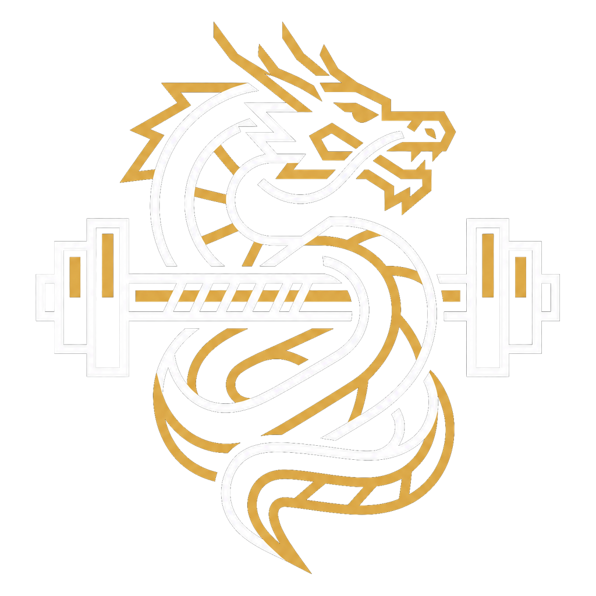
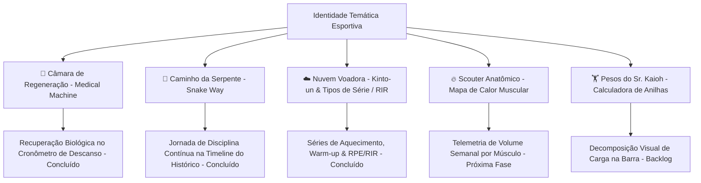

  
   
  <h1 align="center">Propostas Temáticas & Próximos Passos Saiyajin</h1>

Este documento consolida e detalha o planejamento das próximas evoluções temáticas do **Gym Saiyajin**, conectando elementos canônicos do universo Dragon Ball à fisiologia do treino de força e hipertrofia de forma sóbria, elegante e esportiva.

---

## 🧭 Visão Geral das Propostas

---

## 🧪 Proposta 1: A "Câmara de Regeneração Médica" no Cronômetro de Descanso [✅ CONCLUÍDO]

### 1. Justificativa & Lore Canônica
- **Conceito Biológico**: Em Dragon Ball Z, a Câmara de Regeneração Médica (*Medical Machine / Cápsula de Namekusei*) é o ápice da biotecnologia de cura onde Goku se recuperou após as batalhas devastadoras contra as Forças Ginyu.
- **Aplicação no Treino**: No treinamento de musculação, o período de descanso entre séries é a janela de regeneração de ATP-CP, tamponamento de íons de hidrogênio e restauração neuromuscular para a próxima batalha de alta carga.

### 2. Implementação Final Entregue
- **Escotilha Industrial com Rebites (`EscotilhaCamaraPainter`)**:
  - Moldura circular exterior em titânio escuro chanfrado com 8 rebites prateados tridimensionais.
  - Anel de fluido bioenergético em **Ouro Super Saiyajin e Laranja Ki** (`#FFD700` $\to$ `#FF8C00`), harmonizado com a identidade visual do app.
  - Micro-bolhas procedurais animadas subindo continuamente e silhueta discreta da máscara de oxigênio submersa.
  - Chip superior de telemetria médica (`REGENERAÇÃO` / `PAUSADO` / `CÂMARA DE CURA`).
  - Sincronização matemática exata entre tempo restante e descanso acumulado via arredondamento com teto (`ceil`), eliminando qualquer delay de 1s.

---

## 🐍 Proposta 2: Histórico de Treinos como o "Caminho da Serpente" (*Snake Way*) [✅ CONCLUÍDO]

### 1. Justificativa & Lore Canônica
- **Conceito Biológico**: O Caminho da Serpente (*Serpentine Road / Snake Way*) tem 1 milhão de quilômetros e representa a maior prova de disciplina, persistência inabalável e condicionamento que Goku enfrentou para treinar com o Senhor Kaioh.
- **Aplicação no Treino**: A hipertrofia e a força não são construídas em uma única sessão, mas sim na constância de centenas de treinos ao longo dos meses e anos. A timeline do histórico deve transmitir essa sensação de jornada épica e acumulada.

### 2. Implementação Final Entregue
- **Barra Senoidal Suave Sempre Visível (`CaminhoSerpenteProgressBar`)**:
  - Modelagem matemática em função senoidal contínua ($2.5$ ciclos), drop shadow realista e nuvens celestiais do Outro Mundo.
  - Indicador de Ki do guerreiro que se move em tempo real conforme os quilômetros são conquistados.
  - Ponto de chegada ornado com o ícone vetorial cel-shaded em 3D do **Planeta do Sr. Kaioh** (`PlanetaKaiohIcon`).
  - Selo marcial oficial do Senhor Kaioh (**界王**) com tipografia destacada e aro dourado no topo.
- **Card Interativo & Odômetro de Ferro**:
  - Exibição de porcentagem percorrida e chevron animado.
  - Toque no card expande as métricas consolidadas: Odômetro numérico detalhado (`X km / Meta: 1.000.000 km`), marco narrativo de lore e os 3 cards (*Carga Total*, *Tempo Total* e *Sessões*).
- **Harmonização da Linha do Tempo**:
  - Sessões sempre expandidas para consulta imediata de exercícios e séries sem atrito.
  - Nós uniformes com ícone de calendário Saiyajin (`Icons.calendar_month`).
  - Linha única horizontal para Data, Divisão e Badge de PRs, com menu unificado `⋮`.

---

## ☁️ Proposta 3: A "Nuvem Voadora" (*Kinto-un*) & Tipos de Séries com Métrica de Esforço (RPE / RIR) [✅ CONCLUÍDO]

### 1. Justificativa & Lore Canônica
- A Nuvem Voadora (*Kinto-un*) representa leveza, pureza e fluidez de movimento sem peso ou fadiga destrutiva.
- **Aplicação Fisiológica no Treino de Força**:
  - **Séries de Aquecimento / Warm-up (Kinto-un)**: Séries preparatórias neuromusculares com cargas progressivas para lubrificação articular e recrutamento de unidades motoras sem gerar fadiga limitante.
  - **Proteção de Métricas**: Séries marcadas com a insígnia da Nuvem Voadora não poluem o cálculo de 1RM estimado (Epley) nem geram falsos recordes de PRs.
  - **Métrica de Esforço (RPE / RIR - Reps in Reserve)**: Seletor opcional de esforço subjetivo por série (ex: `RIR 2 • RPE 8`), fundamental para o treinamento de atletas intermediários e avançados que gerenciam a fadiga do sistema nervoso central (SNC).

### 2. Implementação Final Entregue
- **Componente Vetorial `KintoUnIcon` (`KintoUnPainter`)**:
  - Renderização em Canvas puro da Nuvem Voadora cel-shaded com gradiente dourado suave (`#FFD700` $\to$ `#FFA000`), rastro aerodinâmico e halo de Ki.
- **Classificação Biomecânica de Séries (`TipoSerie` & `SerieRowWidget`)**:
  - Toque rápido no indicador circular da série alterna ciclicamente entre **Normal** (`N` / índice numérico), **Aquecimento Kinto-un** (`W` / `KintoUnIcon`), **Drop-set** (`D` ciano bioelétrico) e **Falha Total** (`F` rubro com atribuição automática de `RIR 0 / RPE 10`); toque longo abre modal explicativo de seleção direta.
- **Seletor Retrátil de Esforço (`RIR 0` a `RIR 4+` / `RPE 10` a `RPE 6`)**:
  - Pill compacto na base da linha de série que expande horizontalmente os chips de RIR/RPE sem comprometer a digitação rápida de `Peso × Reps`.
- **Persistência SQLite v4 & Blindagem de PRs**:
  - Migração automática do banco (`v3` $\to$ `v4`) adicionando `tipo` e `rir` à tabela `series`, suporte integral no backup JSON e filtragem automática de séries `warmup` nos cálculos de 1RM, PRs em tempo real e gráficos de progressão.

---

## 🔥 Proposta 4: O "Scouter Anatômico" (Mapa de Calor Muscular / Muscle Heatmap) [✅ CONCLUÍDO]

### 1. Justificativa & Lore Canônica
- O Scouter dos Saiyajins é a ferramenta definitiva de telemetria biológica, capaz de detectar assinaturas de poder, assimetrias e níveis de energia dos guerreiros.
- **Aplicação no Treino**:
  - Visualização de **Mapa de Calor Corporal** (silhueta anatômica frontal e dorsal lado a lado em moldura HUD Scouter).
  - O estresse mecânico e o volume acumulado ($\sum \text{séries válidas} \times \text{grupo muscular}$, excluindo séries de aquecimento) colorem os 7 grupos anatômicos canônicos (`PEITO`, `COSTAS`, `PERNAS`, `OMBROS`, `BÍCEPS`, `TRÍCEPS`, `ABDÔMEN`) em tempo real: de **Sem Estímulo** (`#455A64` aço escuro) a **Ativado** (`#00E5FF` ciano bioelétrico), **Zona Ideal** (`#FFD700` ouro Super Saiyajin) e **Sobrecarga** (`#FF5252` rubro Kaioken).

### 2. Especificação Técnica Implementada
- **Telemetria Fisiológica (`ProgressoController` & `TelemetriaMuscular`)**:
  - Alternância de janela temporal entre **7 DIAS** e **30 DIAS** com escalonamento proporcional das faixas fisiológicas de hipertrofia (`6–12` séries/semana para Zona Ideal).
  - Detecção automática de **Pontos Fracos na Armadura** (*lagging muscles*) e integração direta com o maior `1RM` estimado de cada grupo muscular.
- **Renderização Anatômica Interativa (`ScouterAnatomicoWidget` & `muscle_mapper`)**:
  - Silhuetas anatômicas Frontal (`AnatomyView.front`) e Dorsal (`AnatomyView.back`) em SVG via `MuscleMapper` (`DarkThemeAnatomyProvider`), com cabeçalho limpo **`MAPA DE CALOR MUSCULAR`**, seleção interativa por toque direto nos feixes musculares (`onMuscleTapped`) ou nos chips de telemetria rápida e painel detalhado de volume + 1RM.

---

## 🏋️ Proposta 5: "Pesos Pesados do Senhor Kaioh" (Calculadora de Anilhas e Barra) [📋 BACKLOG]

### 1. Justificativa & Lore Canônica
- Para treinar Goku sob gravidade ampliada de 10x, o Senhor Kaioh colocou pesadas braçadeiras de treinamento que forçaram a superação dos limites biológicos básicos.
- **Aplicação no Treino**:
  - Calculadora de anilhas (*Plate Calculator*) rápida para exercícios de barra livre (Supino, Agachamento, Levantamento Terra, Desenvolvimento).
  - Ao tocar no campo de carga ou em um ícone de anilha na série, um modal visual exibe a decomposição exata das anilhas necessárias por lado (ex: Barra de 20 kg + 2 anilhas de 20 kg + 1 anilha de 10 kg por lado = 80 kg).

---

## 🗓️ Tabela Comparativa & Status do Roadmap

| Proposta | Componente Principal | Onde Atua | Complexidade | Status |
| :--- | :--- | :--- | :--- | :--- |
| **🧪 Câmara de Regeneração** | `EscotilhaCamaraPainter` + Cronômetro | `TreinoScreen` (Tela de Treino) | Alta (Painter 3D + animação + sync) | **✅ CONCLUÍDO & TESTADO** |
| **🐍 Caminho da Serpente** | Barra Senoidal + `PlanetaKaiohIcon` + Odômetro | `HistoricoScreen` (Tela de Histórico) | Alta (Painter senoidal + métricas) | **✅ CONCLUÍDO & TESTADO** |
| **⚡ Chamas de Ki** | `KiAuraIcon` + `KiAuraPainter` | `PoderLutaCardWidget` & `Recordes` | Média (Silhueta cel-shaded + glows) | **✅ CONCLUÍDO & TESTADO** |
| **☁️ Nuvem Voadora & RIR/RPE** | `KintoUnIcon` + Seletor de Tipo de Série | `SerieRowWidget`, `Historico` & `DB v4` | Média (Tipos de série + filtro de 1RM) | **✅ CONCLUÍDO & TESTADO** |
| **🔥 Scouter Anatômico** | `MuscleHeatmapPainter` (Frontal / Dorsal) | `ProgressoScreen` (Dashboard) | Média/Alta (Geometria vetorial + mapeamento) | **✅ CONCLUÍDO & TESTADO** |
| **🏋️ Pesos do Sr. Kaioh** | `CalculadoraAnilhasModal` | `SerieRowWidget` / Campos de Carga | Baixa/Média (Algoritmo guloso de anilhas) | **🚀 Próxima Prioridade** |

---

## 📋 Próximos Passos de Execução Recomendados

1. **Fase 1: Nuvem Voadora & Tipos de Série com Métrica de Esforço (Kinto-un & RPE/RIR)**:
   - Desenhar o `KintoUnIcon` vetorial em Canvas.
   - Adicionar tag de tipo de série no modelo `Serie` (`tipo: normal | warmup | dropset | falha`).
   - Ajustar o cálculo do Ki e estimativa de 1RM para ignorar séries marcadas como aquecimento (`warmup`).
   - Adicionar seletor discreto e opcional de RIR/RPE.
2. **Fase 2: Scouter Anatômico (Mapa de Calor Muscular)**:
   - Criar silhuetas vetoriais anatômicas frontal e dorsal com mapeamento dos 6 grandes grupos musculares.
   - Colorir regiões musculares dinamicamente com base nas séries concluídas nos últimos 7 dias.
3. **Fase 3: Pesos Pesados do Senhor Kaioh (Calculadora de Anilhas)**:
   - Implementar algoritmo guloso de seleção de anilhas configurável (anilhas de 25kg, 20kg, 15kg, 10kg, 5kg, 2.5kg, 1.25kg e peso da barra).
